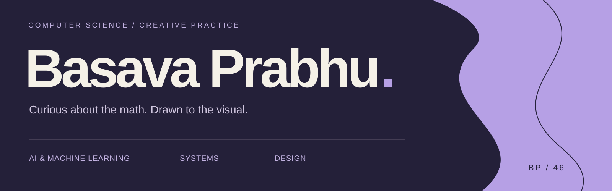
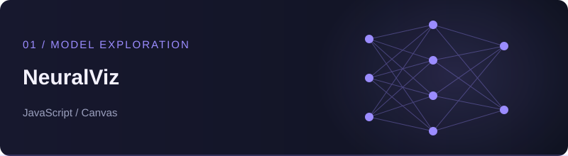
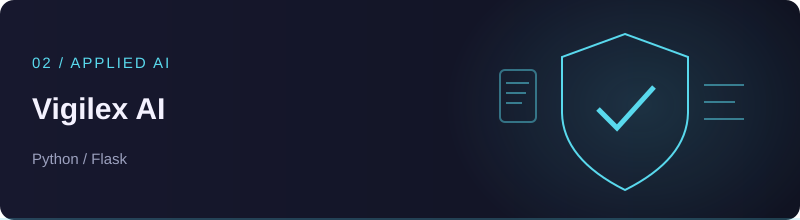
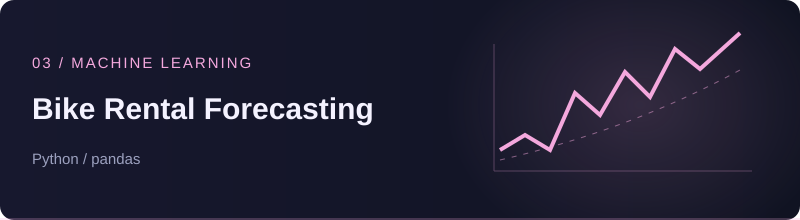
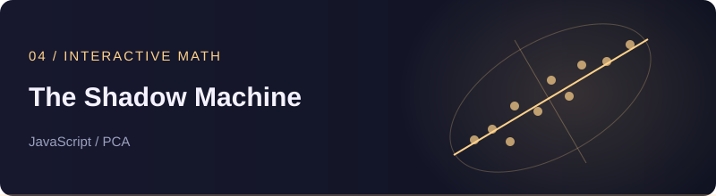
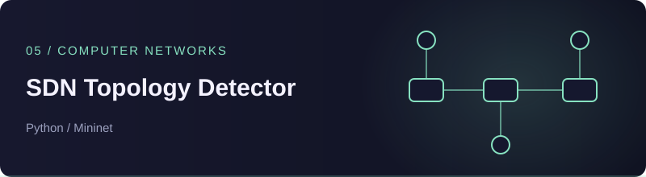

<h3>👋 Hey there! I'm Basava — curious about the math behind intelligent systems.</h3>

<b>CSE undergraduate at PES University, Bengaluru</b> Building things. Understanding how they work. Making them feel right.

<a href="#about">About</a> · <a href="#projects">Projects</a> · <a href="#toolkit">Toolkit</a> · <a href="#stats">Stats</a> · <a href="#beyond-code">Beyond code</a>

 

<h2 id="about">🧠 A little about me</h2>

I'm a **3rd-year Computer Science student** interested in **AI, ML, and how LLMs work under the hood**. I enjoy connecting theory with things I can build — whether that's a RAG pipeline, a visual explanation of linear algebra, or a network controller.

I bring the same curiosity to **photography, art, and design**. For me, understanding a system and making it understandable to someone else go hand in hand.

> **What connects my work:** exploring intelligent systems, turning math into intuition, and building useful interfaces.

 

<h2 id="projects">🚀 Projects worth opening</h2>

A selection spanning applied AI, machine learning, interactive math, and systems.

<table>
<tr>
<td width="50%" valign="top">

<h3>See what is inside the network.</h3>

Drop a PyTorch checkpoint into your browser to explore layers, weights, biases, and simulated forward-pass activations.

Single-file app · Local processing · Interactive canvas

<code>JavaScript</code> <code>Canvas</code> <code>PyTorch checkpoints</code>

<a href="https://github.com/Basavaprabhu46/NeuralViz"><b>Explore NeuralViz →</b></a>

</td>
<td width="50%" valign="top">

<h3>From documents to grounded answers.</h3>

A team-built privacy-policy research assistant combining local embeddings, legal-document retrieval, and a map-reduce analysis pipeline.

Document upload · Source-grounded Q&amp;A · Policy analysis

<code>Python</code> <code>Flask</code> <code>LangChain</code> <code>ChromaDB</code>

<a href="https://github.com/Basavaprabhu46/Vigilex-AI"><b>Explore Vigilex AI →</b></a>

</td>
</tr>
<tr>
<td width="50%" valign="top">

<h3>Turn patterns into predictions.</h3>

Predict hourly and daily demand using time and weather features, with chronological splits and time-series cross-validation.

Model comparison · Ablation studies · Error analysis

<code>Python</code> <code>pandas</code> <code>scikit-learn</code>

<a href="https://github.com/Basavaprabhu46/bike-rental-forecasting"><b>Explore Bike Rental Forecasting →</b></a>

</td>
<td width="50%" valign="top">

<h3>Make linear algebra click.</h3>

Move data points and rotate a projection axis to discover the direction of maximum variance — an interactive introduction to PCA.

Editable data cloud · Live variance · Zero dependencies

<code>JavaScript</code> <code>PCA</code> <code>Visualization</code>

<a href="https://github.com/Basavaprabhu46/pca-variance-interactive-visualiser"><b>Explore The Shadow Machine →</b></a>

</td>
</tr>
<tr>
<td width="50%" valign="top">

<h3>Watch the network change.</h3>

Track switch and link events with a Ryu controller and Mininet, updating the topology map and timestamped event logs.

OpenFlow 1.3 · MAC learning · Link-event monitoring

<code>Python</code> <code>Mininet</code> <code>Ryu</code>

<a href="https://github.com/Basavaprabhu46/sdn-topology-detector"><b>Explore SDN Topology Detector →</b></a>

</td>
<td width="50%" valign="top">

<h3>Find the signal in the message.</h3>

Classify SMS messages using TF-IDF, truncated SVD, and cosine similarity to class centroids, with held-out evaluation.

Latent semantic space · Precision/recall tradeoff

<code>NumPy</code> <code>scikit-learn</code> <code>Jupyter</code>

<a href="https://github.com/Basavaprabhu46/Latent-Semantic-Analysis-SMS-Spam-Detection"><b>Explore LSA-SpamGuard →</b></a>

</td>
</tr>
</table>

 

<h2 id="toolkit">🛠️ Tools I build with</h2>

<h4>Languages</h4>

<h4>AI, ML & data</h4>

<h4>Web & databases</h4>

<h4>Creative studio</h4>

**Foundations:** Data structures & algorithms · Algorithm design · Operating systems · Computer networks · Linear algebra

 

<h2 id="stats">📊 GitHub stats</h2>

 

Cards refresh periodically. Language distribution is based on repository count.

 

<h2 id="beyond-code">🎨 A creative life beyond the terminal</h2>

**Core Member, Pixelloid — PES University's media club** *(2024–Present)*

When I'm not debugging or exploring a new concept, you'll find me with a camera, making art, or working on a design. Different tools, same curiosity.

<b>📸 Photography &nbsp; / &nbsp; 🎨 Art &nbsp; / &nbsp; ✦ Design</b>

 

<i>“Curious about the math behind intelligent systems.”</i>

<a href="https://www.linkedin.com/in/basavaprabhu46/">Let's connect</a> · <a href="https://github.com/Basavaprabhu46?tab=repositories">Explore all repositories</a>

